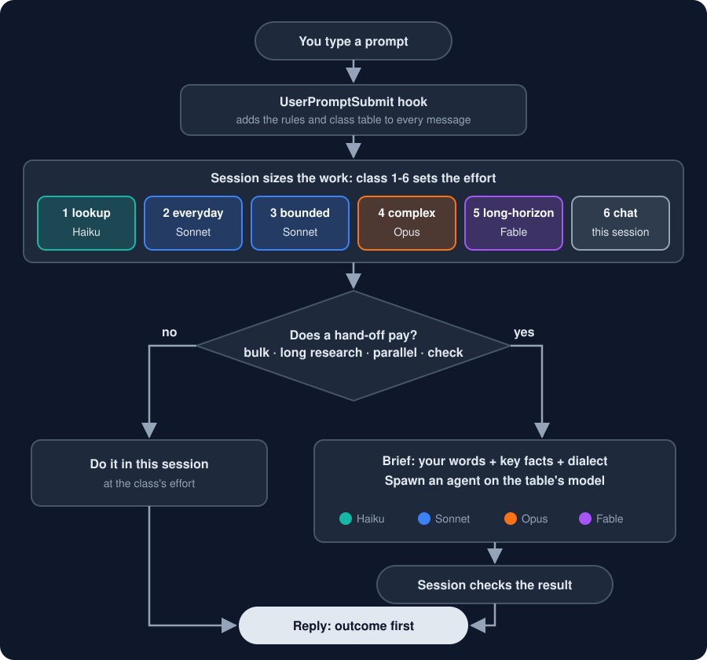

<div align="center">
  

  <h1>🗣️ claude-dialect</h1>
  <h3><em>Do the work here. Hand off only when it pays — and then speak that model's dialect.</em></h3>

  <p>
    <a href="LICENSE"></a>
    <a href="https://github.com/Jimmycarroll2021/claude-dialect/stargazers"></a>
    <a href="https://github.com/Jimmycarroll2021/claude-dialect/commits/main"></a>
    
  </p>
</div>

A small Claude Code add-on that makes every session size its work, keep it in the session by default, and hand off to another Claude model only when that clearly pays: bulk jobs to **Haiku 5.5**, long research to **Fable 5.2**, parallel parts and independent checks to their own agents.

When it does hand off, the brief is **your request word for word** (never a summary, which loses nuance), plus **the facts the agent needs from your conversation** (it starts with none), plus **that model's own rules** from Anthropic's prompting guides. For example, Opus gets "double-check" lines removed because it verifies on its own, while Sonnet is told to stop when the work is done instead of adding extras.

Why not route everything? A hand-off starts a fresh agent that has to reload context and re-read files. For a git status check or a small edit, that costs more than the work. Raising effort on the current model usually beats switching model, which Anthropic's model guide also says.

<div align="center">
  
</div>

## How it works

<div align="center">
  
</div>

| Piece | Installed to | Job |
|---|---|---|
| `hooks/claude-dialect-route.sh` | `~/.claude/hooks/` | `UserPromptSubmit` hook: injects the work-here-by-default rule, the class table and the hand-off triggers on every message, so it does not depend on the model remembering to load the skill |
| `skills/optimise-prompt/` | `~/.claude/skills/` | The skill: interpret, size, do it here or brief and hand off. `references/` holds the routing table and one guidance file per model |
| `bin/claude-dialect-check.py` | `~/.claude/bin/` | `SessionStart` hook: warns if the prompt hook is missing or any guidance file is more than 30 days old |
| `CLAUDE.snippet.md` | appended to `~/.claude/CLAUDE.md` | The same rule for your own instructions, between `claude-dialect:start/end` markers |

### The classes

The class sets the **effort** for work done here, and the **model** only if the work is handed off.

| Class | Looks like | Model if handed off · effort |
|---|---|---|
| 1 lookup | find, list, grep, classify, extract | Haiku · medium (bulk: low) |
| 2 everyday | write a function, draft copy, analyse a CSV | Sonnet · high |
| 3 bounded | exact files + exact change + a named check | Sonnet · medium |
| 4 complex | unknown root cause, refactor, architecture, review | Opus · medium |
| 5 long-horizon | hours of research ending in a finished document | Fable · high |
| 6 chat | answerable with no tool call | never handed off |

### When it hands off

Only when one of these holds:

1. **Bulk or context-flooding work:** many files or items, long logs, wide searches. These go to an agent on the table's model.
2. **Class 5 long-horizon work:** this goes to Fable.
3. **Independent parts that can run in parallel.**
4. **An independent check of something about to go public.**
5. **The work already fell short here at higher effort:** this goes to the next model up (Haiku, then Sonnet, then Opus, then Fable).

Everything else is done in the session. "Be thorough" raises effort one level instead of adding words. A follow-up on an agent's work continues that same agent, so its context is kept.

## Install

Needs Claude Code and `python3`.

```bash
git clone https://github.com/Jimmycarroll2021/claude-dialect
cd claude-dialect
./install.sh
```

Then start a new Claude Code session. The installer is safe to rerun. It backs up `settings.json` and `CLAUDE.md` first, keeps any hooks you already have, and moves an existing `optimise-prompt` skill aside instead of overwriting it.

Uninstall with `./uninstall.sh`. It removes only what the installer added.

## Prove it works

```bash
python3 tests/run.py          # 12 sample prompts, dry run: checks the class picked (~2 min)
python3 tests/delegation.py   # 6 real tasks in a temp folder: checks hand-offs AND the actual answers (~6 min, uses tokens)
```

Both run `claude -p --model sonnet`. `delegation.py` checks that:

- **Small work stays put:** a git status check, a small script and a flaky-test fix are done in the session, and the fix must then pass 5 runs.
- **Bulk work comes back right:** 200 support tickets must come back at least 98% correctly classified.
- **Context carries over:** a rule given in an earlier turn must be applied.
- **Hand-off briefs are complete:** an "independent check before I publish" is handed off, and its brief must contain your request word for word plus a fact from the earlier turn.

Results on the author's machine (2026-11-19): routing 12/12, delegation 6/6.

## Using it

- Just type as normal. When work is handed off you see one line, e.g. `Route: fable · high · class 5 long-horizon`.
- `/optimise-prompt --show <query>` shows the route and the rewritten prompt without running anything.
- `/optimise-prompt --model opus <query>` forces a model.

## Cost note

Most work stays on your session's model, so cost stays close to normal. Hand-offs to Haiku are cheaper. Hand-offs to Fable (about 4x Sonnet per token) happen only for long-horizon work. To change that, edit the class table in `hooks/claude-dialect-route.sh` and `references/routing.md`, then rerun `./install.sh` and the tests.

## Keeping it current

The guidance files carry a `last_verified` date. The session-start check warns after 30 days. To refresh, ask Claude to "refresh the optimise-prompt guidance from the Claude prompting docs". The sources are listed at the top of each file:

- [Prompting best practices](https://platform.claude.com/docs/en/build-with-claude/prompt-engineering/claude-prompting-best-practices)
- Per model: [Opus 5.5](https://platform.claude.com/docs/en/build-with-claude/prompt-engineering/prompting-claude-opus-5-5), [Opus 5](https://platform.claude.com/docs/en/build-with-claude/prompt-engineering/prompting-claude-opus-5), [Fable 5.2](https://platform.claude.com/docs/en/build-with-claude/prompt-engineering/prompting-claude-fable-5-2), [Sonnet 5.5](https://platform.claude.com/docs/en/build-with-claude/prompt-engineering/prompting-claude-sonnet-5-5), [Haiku 5.5](https://platform.claude.com/docs/en/build-with-claude/prompt-engineering/prompting-claude-haiku-5-5)
- [Models overview](https://platform.claude.com/docs/en/models/overview), [Effort](https://platform.claude.com/docs/en/build-with-claude/effort)

Then rerun both tests.

## License

MIT. See `LICENSE`.
